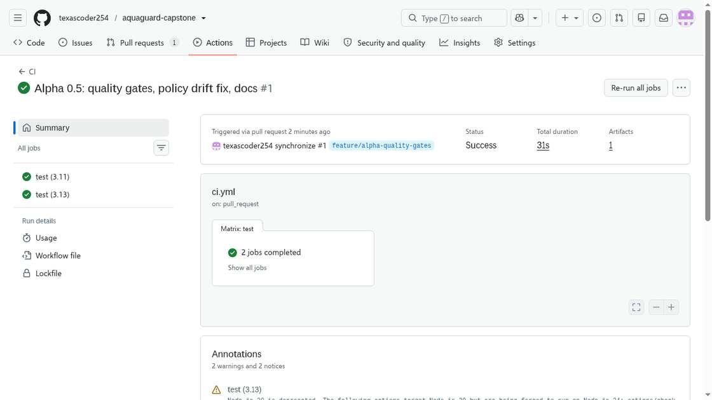
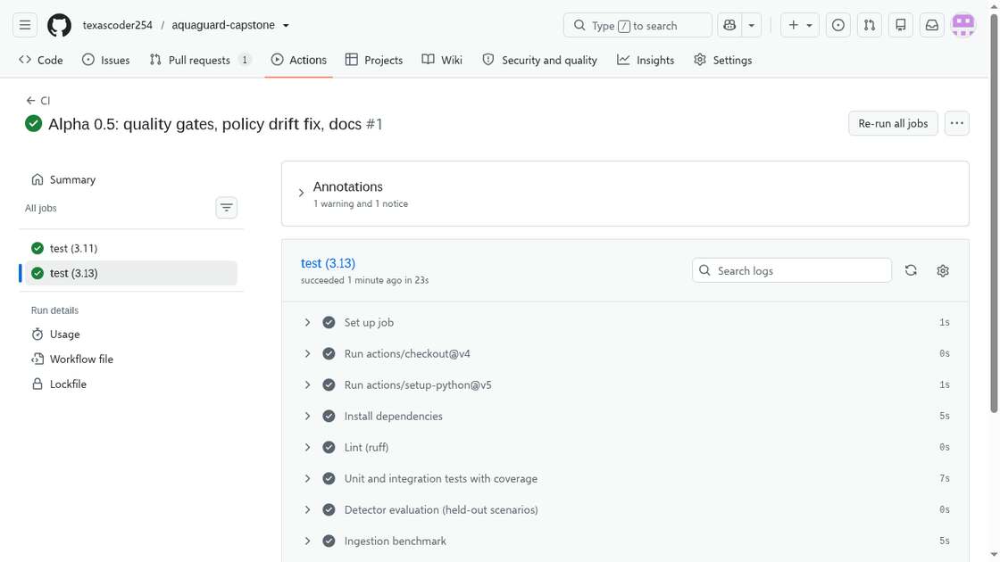

# CI/CD evidence

The GitHub Actions workflow [`.github/workflows/ci.yml`](../.github/workflows/ci.yml) runs on every pull request,
on pushes to `main`, and on demand (`workflow_dispatch`). It tests a Python 3.11 / 3.13 matrix.

## Pipeline stages (each one is a gate: any failure fails the build)

| # | Stage | Command | Gate |
| --- | --- | --- | --- |
| 1 | Lint | `ruff check app tests scripts` | zero findings (rules E, F, W, I, B) |
| 2 | Tests + coverage | `pytest -q --cov=app --cov-fail-under=85` | all 32 tests pass, coverage ≥ 85% (actual 91%) |
| 3 | Detector evaluation | `python -m scripts.evaluate_detector` | held-out metrics written to `docs/metrics/detector.json` |
| 4 | Ingestion benchmark | `python -m scripts.benchmark --n 1000` | latency written to `docs/metrics/benchmark.json` |
| 5 | Quality gate | `python -m scripts.check_metrics` | rise detection ≥ 80%, false alarms ≤ 10%, 95% of readings visible ≤ 2 s |
| 6 | Artifacts | `actions/upload-artifact@v4` (3.13 only) | coverage.xml + metrics JSON kept with the run |

## First run

- Run: [CI #1 — Alpha 0.5: quality gates, policy drift fix, docs](https://github.com/texascoder254/aquaguard-capstone/actions/runs/42376818299)
- Trigger: `pull_request` on PR #1 (`feature/alpha-quality-gates`, head `9b955f5`), 2026-11-07 13:24 UTC
- Result: **success** — `test (3.11)` and `test (3.13)` both green; total duration 31 s; 1 artifact uploaded

## Notes

- The workflow file was added through the GitHub web UI because the API integration token used for the
  other commits does not carry the `workflow` scope.
- GitHub reports a deprecation notice for Node 20-based actions; upgrading `actions/*` versions is tracked
  with the other maintenance items in [TECHNICAL_DEBT.md](TECHNICAL_DEBT.md).
- Branch protection on `main` (require the CI check before merge) is recommended for the beta.

*Developed with AI assistance; see [AI_USAGE.md](AI_USAGE.md).*
