# Screenshots

Captured from a local run (`uvicorn app.server:app`) with simulator data (`--scenario gradual_rise --seed 12`).
Images are SVG wrappers around JPEG captures.

| # | Screen | Image |
| --- | --- | --- |
| 1 | Sign-in | 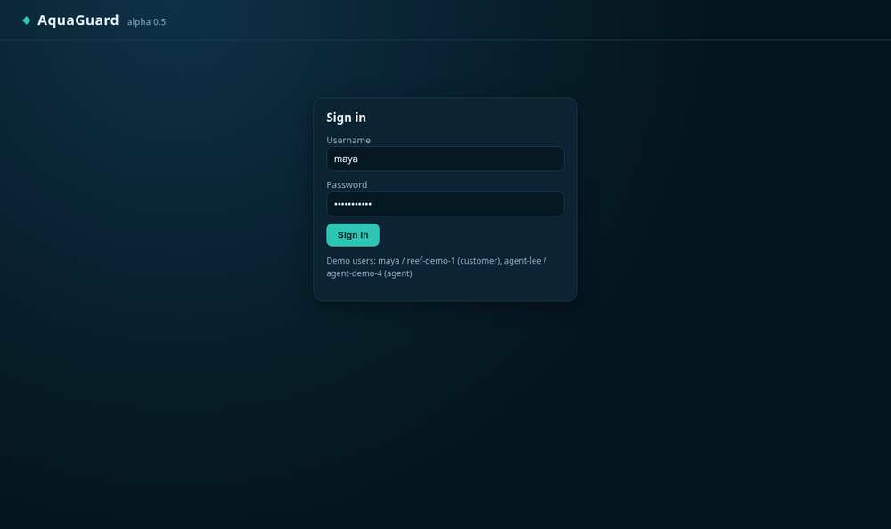 |
| 2 | Dashboard: reef tank rising but still within limits | 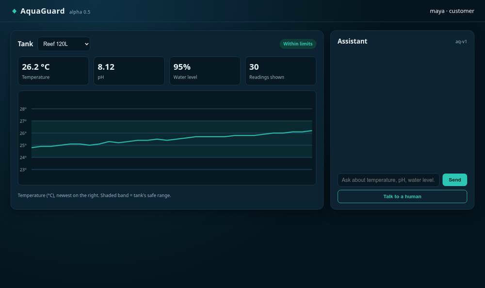 |
| 3 | Assistant detects the rise before the threshold is crossed | 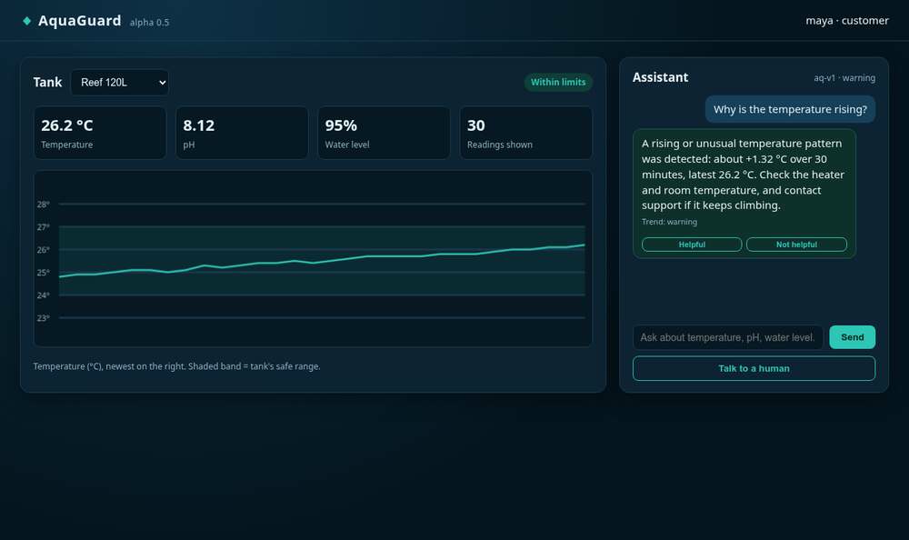 |
| 4 | Feedback recorded | 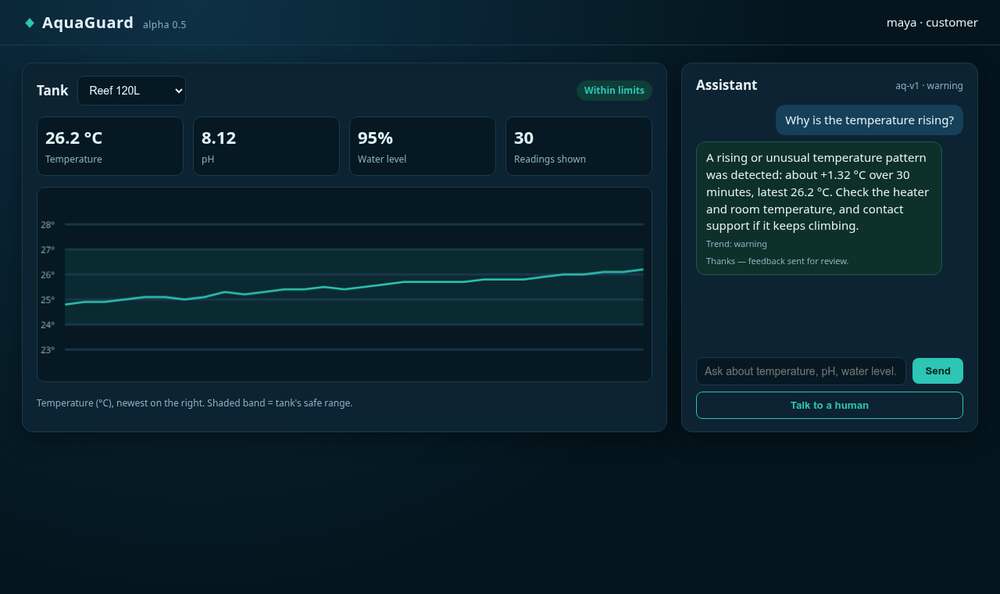 |
| 5 | Out-of-scope question escalated to a human | 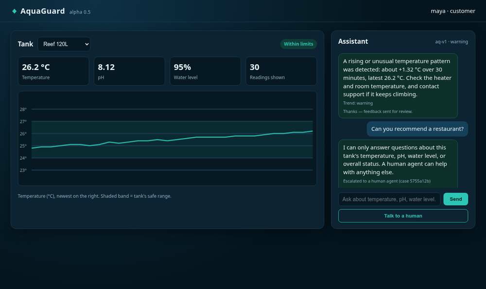 |
| 6 | Second tank (freshwater) normal | 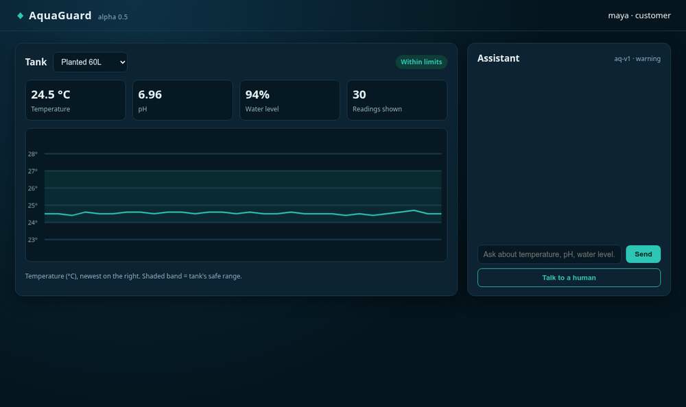 |
| 7 | Agent queue and transcript | 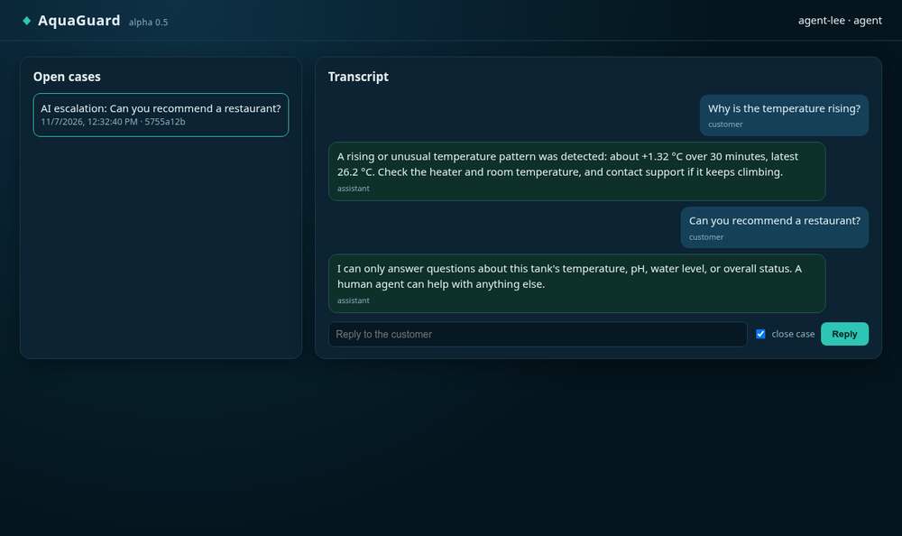 |
| 8 | Agent reply closes the case | 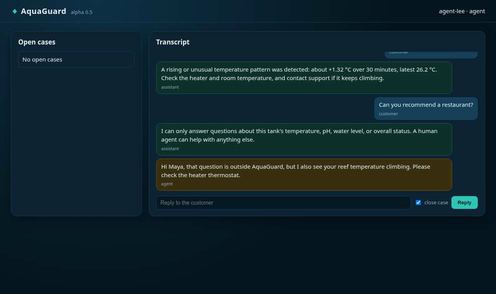 |
| 9 | OpenAPI docs at `/docs` | 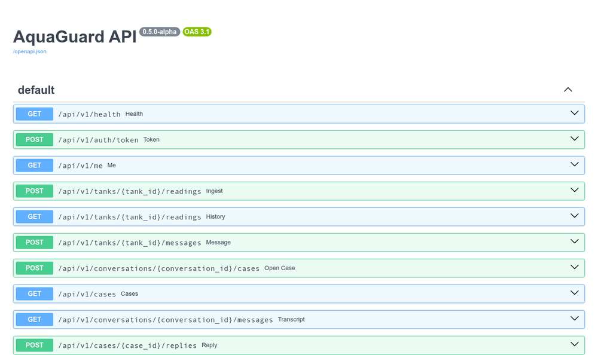 |
| 10 | CI run #1 green on PR #1 (3.11 + 3.13) | 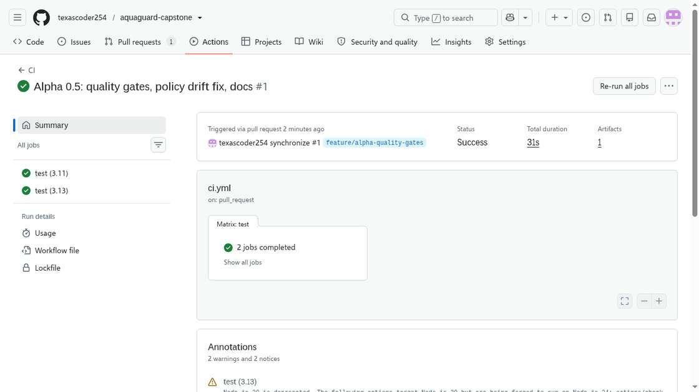 |
| 11 | CI job steps: lint, tests, detector, benchmark, quality gate | 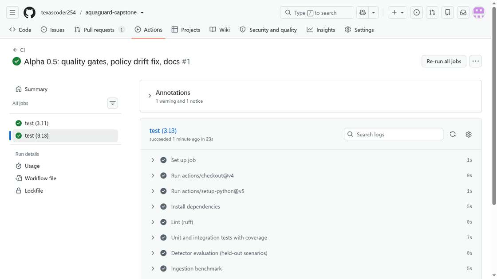 |
