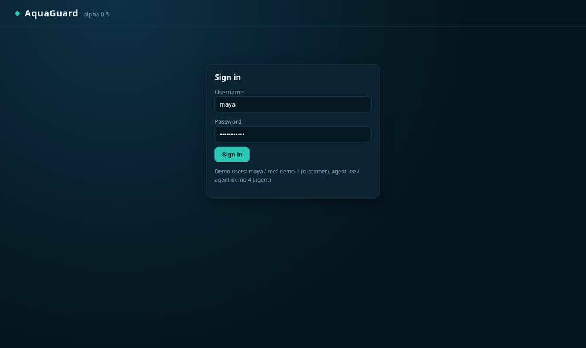
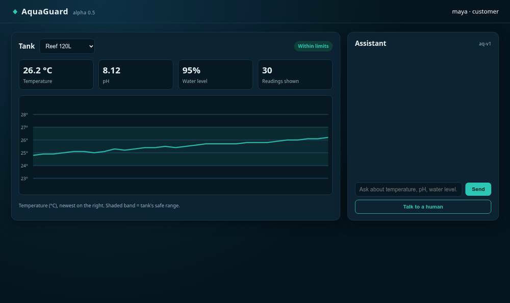
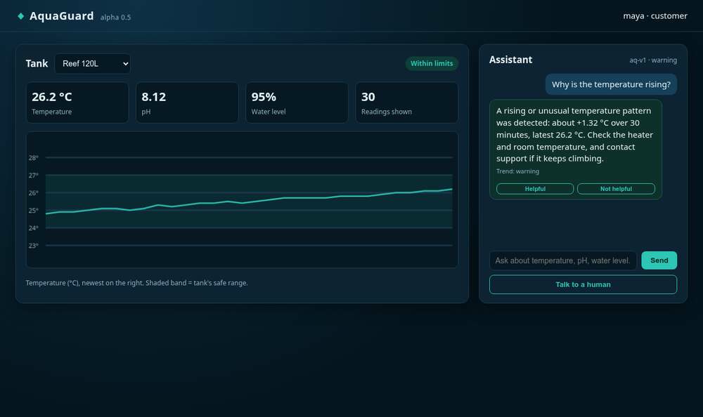
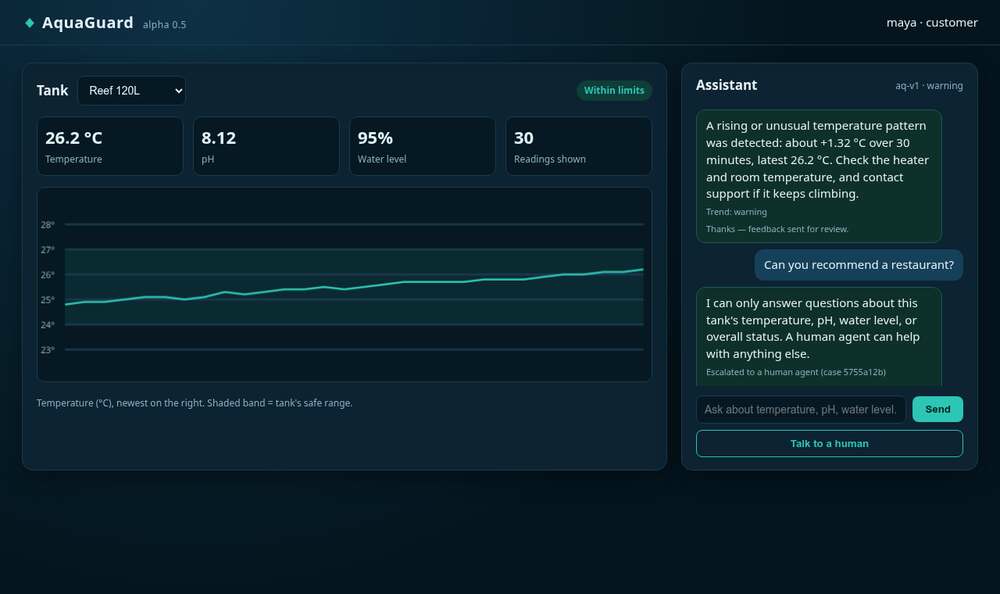
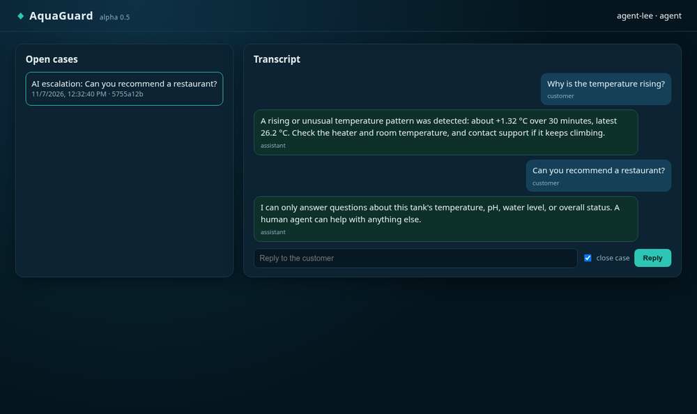
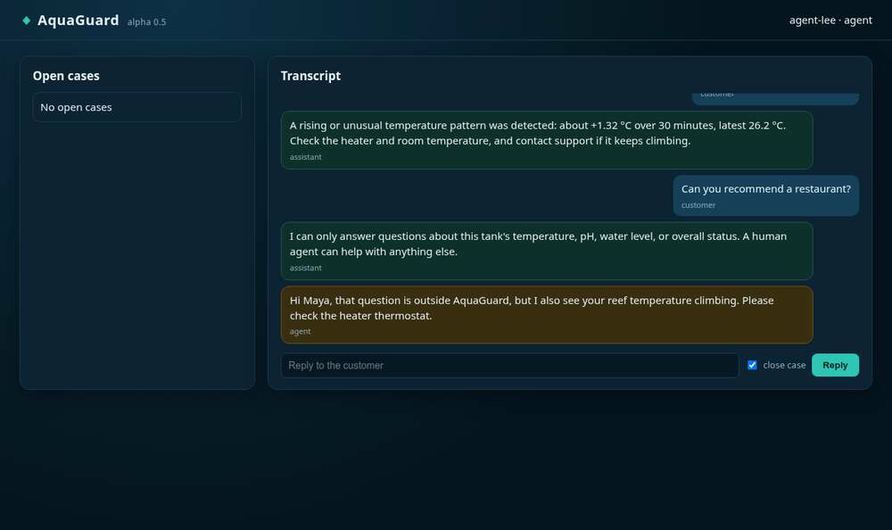

# User manual

AquaGuard has two screens: the **customer dashboard** and the **agent console**. Both open at the service
address (for a local install, http://127.0.0.1:8000).

## Signing in

Enter your username and password and choose **Sign in**. Demo accounts:

| Role | Username | Password |
| --- | --- | --- |
| Customer (reef + planted tanks) | `maya` | `reef-demo-1` |
| Support agent | `agent-lee` | `agent-demo-4` |

Sessions last 30 minutes; sign in again when prompted.

## Customer dashboard

- **Tank selector**: choose which tank to view.
- **Badge**: *Within limits* (green) or *Threshold alert* (red) for the latest reading against the tank's safe range.
- **Stats**: latest temperature, pH, water level, and how many readings are shown.
- **Chart**: temperature over time, newest on the right. The shaded band is the tank's safe range; red dots are
  readings outside it.

### Asking the assistant

Type a question about **temperature, pH, water level, or overall status** and choose **Send**.
Each answer shows the trend result (*normal*, *warning*, or *insufficient data*) and the model version.

- *Warning* means the temperature is rising faster than about 0.45 °C per 30 minutes or the last reading jumped
  sharply. Check the heater, room temperature, and probe placement.
- *Insufficient data* means fewer than 20 readings in the last 30 minutes.

### Getting a person

Choose **Talk to a human** at any time. AquaGuard also hands off automatically when a question is outside its scope
or the AI is unavailable. You will see "Escalated to a human agent" with a case number; the agent's reply appears in
the same conversation.

### Rating answers

Mark an answer helpful or not helpful once. Ratings go to a review queue used to improve the assistant.

## Agent console

- **Open cases** lists escalations for the customers you support, oldest first.
- Select a case to read the full **Transcript** (customer, assistant, and agent messages).
- Type a reply, leave **close case** checked to resolve it, and choose **Reply**.

## Limits of the assistant

AquaGuard is advisory. It does not control heaters, pumps, or dosing equipment, and it only knows what the tank's
sensors report. When in doubt, it asks a person.
